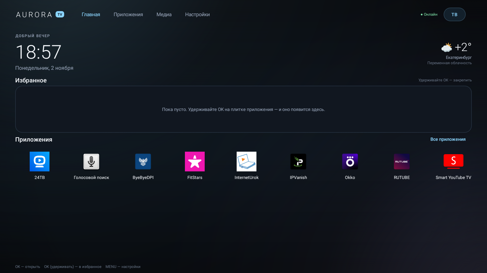
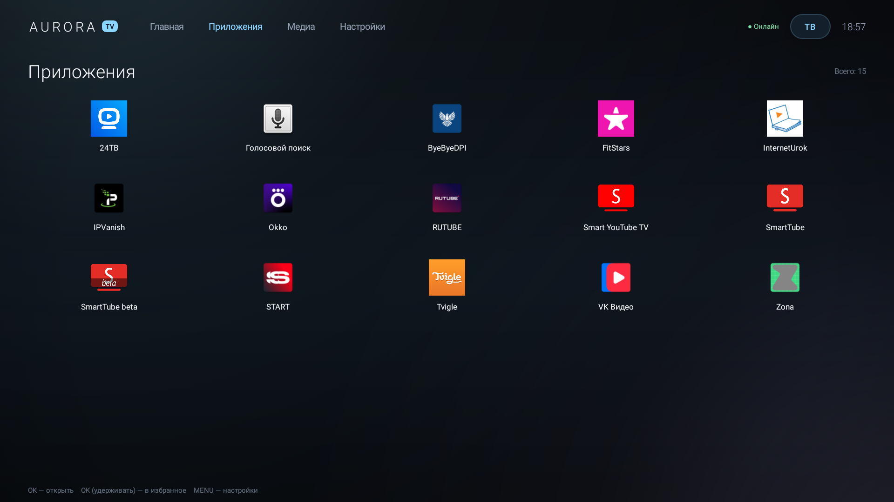
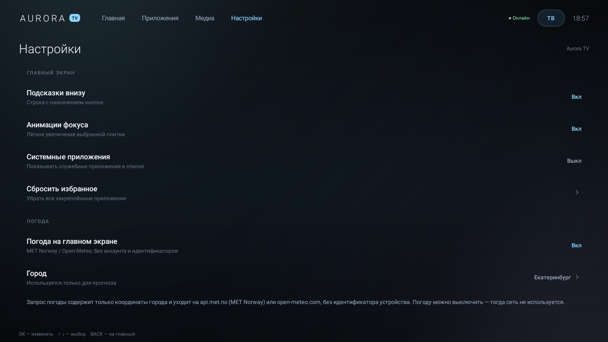
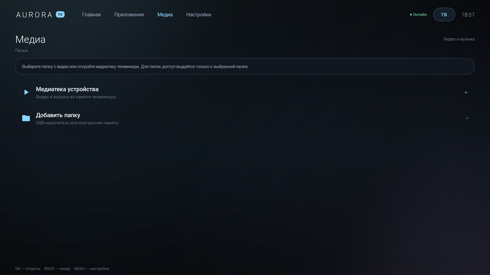

# Aurora TV

[](https://github.com/nenasevartem70-cmyk/aurora-tv/actions/workflows/android.yml)

Лёгкая оболочка (лончер) для **Telefunken Android TV** и совместимых устройств.
Заменяет рабочий стол, но остаётся обычным APK: устанавливается и удаляется по ADB,
без перепрошивки и риска получить «кирпич».

## Что внутри

- **Главный экран**: часы, дата, приветствие, погода, избранное и быстрый доступ к приложениям.
- **Избранное**: удерживайте `OK` на плитке приложения, чтобы закрепить или убрать её.
- **Приложения**: весь список установленных приложений, сетка 5 колонок, поиск не нужен — всё на пульте.
- **ТВ**: кнопка в шапке открывает приложение для каналов. Если тюнер не вынесен в отдельное приложение (как на некоторых Telefunken), кнопка предложит выбрать подходящее приложение из установленных; штатная кнопка `TV` на пульте при этом продолжает работать.
- **Медиа**: доступ к USB-накопителю или папке через системный выбор (SAF). На Android 7–9 дополнительно работает **медиатека**: прямой поиск видео и музыки в `Movies`, `Music`, `Download`, `DCIM` и на USB-накопителях. Встроенный плеер на Media3/ExoPlayer, поддержка видео и музыки, очередь файлов в папке.
- **Настройки**: Wi-Fi, Bluetooth, звук, дисплей, приложения, дата и время, выбор ТВ-приложения, смена города погоды, скрытие системных приложений, отключение анимаций и подсказок.
- **Приватность**: никакой аналитики, рекламы, трекеров и Google Play Services. Единственный сетевой запрос — погода на `api.met.no` (MET Norway) с фолбэком на `open-meteo.com` (координаты города, без идентификатора устройства); её можно выключить. На Android 7–9 медиатека использует разрешение `READ_EXTERNAL_STORAGE`; `install.ps1` выдаёт его автоматически. На новых версиях доступ к файлам — только к папкам, которые вы выбрали вручную.
- **Проверка на устройстве**: Telefunken TF-LED40S19T2S, Android 7.0 (API 24) — запуск, пульт, погода, медиатека и плеер проверены вживую.

## Требования

- Windows 10/11, JDK 17, Android SDK Platform 34 (для сборки).
- Телевизор с Android TV и включённой отладкой по ADB.
- **Путь к проекту должен быть без кириллицы** — например, `C:\AuroraTV`. Android Gradle Plugin на Windows ломается на путях вида `C:\Users\Артем\...`.

## Сборка

```powershell
cd C:\AuroraTV
.\scripts\build.ps1
```

По умолчанию собирается подписанный **release**-APK (~1 МБ, R8, без отладочной информации).
Для отладки: `.\scripts\build.ps1 -DebugBuild`.

APK:

- release: `app\build\outputs\apk\release\app-release.apk`
- debug: `app\build\outputs\apk\debug\app-debug.apk`

Подпись release хранится в `keystore\aurora-release.jks`, пароли — в `keystore.properties`.
**Сохраните эти два файла**: с другим ключом Android не установит обновление поверх старой версии.

Если JDK/SDK не в стандартном месте:

```powershell
$env:JAVA_HOME = "C:\path\to\jdk-17"
$env:ANDROID_HOME = "C:\path\to\android-sdk"
.\scripts\build.ps1
```

## Установка на телевизор

1. Включите на ТВ режим разработчика:
   `Настройки → Система → О телевизоре` → 7 раз нажмите на «Номер сборки».
2. В `Настройки → Система → Для разработчиков` включите **Отладка по сети** (или `ADB over network`).
3. Узнайте IP телевизора в настройках Wi-Fi.
4. С ПК:

```powershell
.\scripts\install.ps1 -TvIp 192.168.1.50
```

Скрипт соберёт (если нужно), установит APK, выдаст доступ к медиатеке, назначит `ru.auroratv.launcher` домашним экраном и запустит оболочку. На Android 7–9 лончер ставится командой `cmd package set-home-activity --user 0 ...`; если прошивка не даёт это сделать, появится предупреждение — выберите Aurora TV в списке лончеров.

Если по сети ADB не включается, подключите ТВ USB-кабелем и выполните:

```powershell
adb tcpip 5555
adb connect 192.168.1.50:5555
.\scripts\install.ps1 -TvIp 192.168.1.50
```

На Android 11+ с «беспроводной отладкой» может понадобиться сопряжение по коду — сделайте это один раз в системных настройках, затем `adb connect IP:PORT`.

## Управление

| Кнопка | Действие |
|---|---|
| `OK` | Открыть приложение / выбрать |
| `OK` (удерживать) | Добавить или убрать из избранного |
| `← → ↑ ↓` | Навигация |
| `MENU` | Настройки Aurora TV |
| `BACK` | Назад / на главный экран |

## Откат

Удалить оболочку и вернуть штатный рабочий стол:

```powershell
.\scripts\uninstall.ps1 -TvIp 192.168.1.50
```

Либо просто удалите приложение в системных настройках Android TV — домашним экраном снова станет штатный лончер.

## Почему это не «прошивка» и почему не будет лагов

Замена системного раздела на Telefunken требует исходников платы и загрузчика — без них любая «прошивка» превращает телевизор в кирпич. Лончер через `HOME`-интент даёт тот же пользовательский эффект: телевизор загружается сразу в Aurora TV, пульт управляет оболочкой, а система и декодеры работают штатно.

Производительность:

- Без Compose: Kotlin + View/RecyclerView;
- иконки и баннеры грузятся в фоне и кэшируются (LruCache);
- сканирование приложений — один раз при старте и при установке/удалении;
- анимации короткие (110–150 мс) и отключаются в настройках;
- APK ~1.1 МБ, без рекламных и аналитических SDK.

Проверено на **Telefunken TF-LED40S19T2S, Android 7.0 (API 24)**: запуск оболочки ~1,8 с, интерфейс пульта, погода, медиатека и плеер работают. После перезагрузки телевизор открывает Aurora TV, а `Home` из приложений возвращает в неё.

Готовый APK: [GitHub Releases](https://github.com/nenasevartem70-cmyk/aurora-tv/releases/tag/v1.0.0) (локально — `dist\AuroraTV-1.0.apk`, SHA-256 в `dist\AuroraTV-1.0.apk.sha256`).

## Скриншоты






## Структура

```
app/src/main/java/ru/auroratv/launcher/
  MainActivity.kt          — HOME-экран, навигация, установка лончера
  core/                    — настройки, список приложений, иконки
  ui/                      — главный экран, приложения, медиа, настройки
  media/PlayerActivity.kt  — плеер Media3
  weather/                 — MET Norway / Open-Meteo, города, кэш
```

## Документация

- [Как это работает](docs/ARCHITECTURE.md)
- [План v2 и собственный обход](ROADMAP.md)
- [SmartTube и сетевой обход](docs/SMARTTUBE.md)
- [История изменений](CHANGELOG.md)

## Лицензия

MIT. Сторонние библиотеки — AndroidX и Media3 (Apache 2.0).
