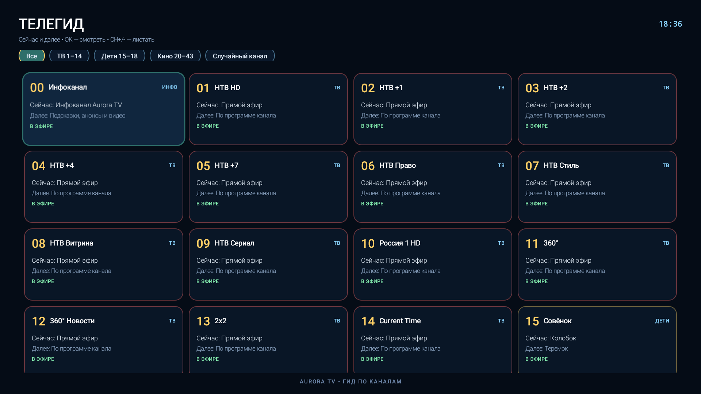

## 🔜 Скоро бета: телегид и 43 канала

Готовим **Aurora TV 1.9-beta6**. В новой бете — долгожданный телегид и расширение кинозалов.

### Что нового

- **Полноэкранный телегид** по всем каналам: 0, ТВ 1–14, дети 15–18, кино 20–43.
  У каждого канала — программа «Сейчас / Далее» и статус эфира.
- **Фильтры**: Все · ТВ 1–14 · Дети 15–18 · Кино 20–43, плюс кнопка случайного канала.
- **Переключение без лаунчера**: `CH+/CH-`, цифры и выбор прямо в гиде — из ТВ-плеера,
  детского канала и кинозала.
- **10 новых киноканалов 34–43**: Aurora Нуар, Триллер, Драма, Классика, Немое кино,
  Приключения, Ретро-комедия, Золотая коллекция, Кинохроника, Ночной клуб.
- Всего в эфире **43 канала**; новогодний канал 33 и праздничное оформление пока остаются.

### Скриншот

### Видео теста телегида

[Смотреть демо (MP4, 21 c)](guide-demo.mp4)

Бету дадим совсем скоро — как только закончим финальную проверку на ТВ.
